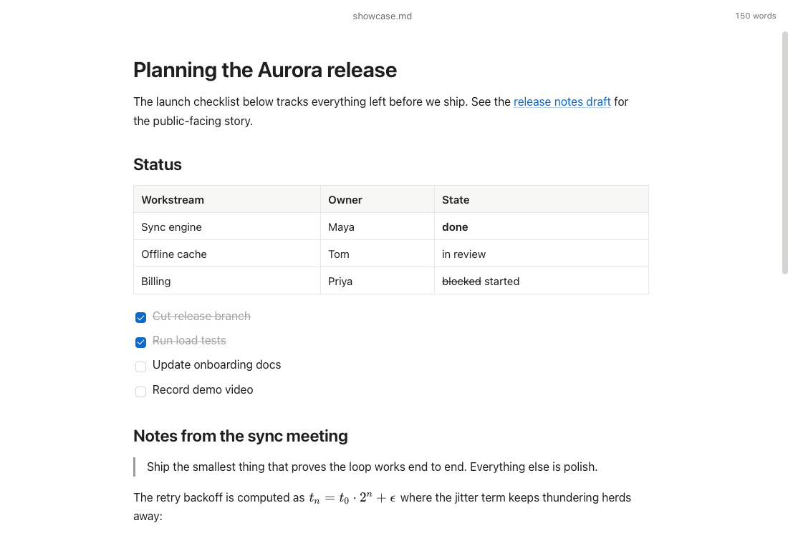

<p align="center">
  
</p>

<h1 align="center">Quill</h1>

<p align="center">
  Open any markdown file instantly as a real document.<br/>
  Notion-style WYSIWYG editing with LaTeX math, Mermaid diagrams, tables, and a ~5 MB app.
</p>

<p align="center">
  Most of what LLMs produce is markdown, and in 2026 opening a lone <code>.md</code> as a real document
  (not raw source) turned into a small rush of tools. Quill's cut: native, block-style WYSIWYG, fully
  open source down to the editor, about 5 MB, and also a VS Code extension. Double-click a markdown
  file and it renders instantly as an editable document. No vault, no Electron.
</p>

<p align="center">
  <a href="#install">Install</a> &middot;
  <a href="#features">Features</a> &middot;
  <a href="#how-quill-compares">Compare</a> &middot;
  <a href="#performance">Performance</a> &middot;
  <a href="#development">Development</a>
</p>

---

## Install

Quill is a native macOS app. Grab the latest `.dmg` from
[Releases](https://github.com/ETM-Code/quill/releases) — `Quill_x.y.z_aarch64.dmg` for Apple Silicon
(M1 and later) or `Quill_x.y.z_x64.dmg` for Intel — open it, and drag **Quill** into Applications.

> **Not on a Mac?** The sibling
> [**Quill for VS Code**](https://marketplace.visualstudio.com/items?itemName=etm-code.quill-vscode)
> extension runs the same editor in VS Code on any platform. Install *Quill Markdown Editor*
> (`etm-code.quill-vscode`) from the Marketplace, or grab a `.vsix` from
> [its releases](https://github.com/ETM-Code/quill-vscode/releases).

### First launch

Quill is ad-hoc signed but not notarized (notarizing needs a $99/yr Apple Developer account, and Quill
is a free side project), so macOS Gatekeeper blocks the first launch of a download. Clear it once:

```bash
xattr -cr /Applications/Quill.app
```

That removes the `com.apple.quarantine` flag and Quill opens normally from then on. No terminal? Open
Quill, let macOS block it, then go to **System Settings → Privacy & Security → Open Anyway**. Or skip
the unsigned binary entirely and build from source — a local build is never quarantined.

### Build from source

```bash
bun install
bun run tauri build
```

The `.app` and `.dmg` land in `src-tauri/target/release/bundle/`. Requires [Bun](https://bun.sh),
[Rust](https://rustup.rs), and Xcode Command Line Tools.

## Features

**Safe to open and save**

- **Unedited text is written back byte for byte.** Quill keeps the original source of every block, so opening and saving a file never rewrites parts you didn't touch. That includes blank-line runs, a missing final newline, CRLF line endings and link reference definitions. Edited blocks keep their meaning, and a second save matches the first.
- **Checked on real drafts.** `harness/fidelity-gate.ts` round-trips 236 inputs, including 60 real Claude-written files, and fails on any change.
- **External changes.** If the file changes on disk, Quill reloads it when you have no unsaved edits and warns, keeping your edits, when you do.

**Writing**

- **WYSIWYG markdown.** Write in rich text, save as plain `.md`. Headings, bold, italic, underline, strikethrough, highlight, sub/sup/kbd, lists, blockquotes, code, links.
- **Beyond CommonMark.** Front matter shows as a collapsed Properties block. Footnotes, GitHub alert callouts (`> [!NOTE]`), `<details>` with editable content, `==highlight==` and `<sub>`, `<sup>`, `<kbd>` are supported. Other raw HTML is kept as written and shown sanitised.
- **Tables.** GFM tables render and edit inline. Set column alignment, add rows and columns on hover, move or delete them.
- **Task lists.** `- [ ]` checkboxes, clickable, round-trip faithfully.
- **LaTeX math.** Inline `$E=mc^2$` and block `$$...$$` via KaTeX. Click an equation to edit it in a popover with live preview. ⇧⌘M or the ∑ button inserts inline math.
- **Mermaid diagrams.** A fenced `mermaid` code block renders as a diagram (or insert one with `/`); click it to edit in a popover with live preview.
- **Code blocks.** Syntax highlighting with a language picker and one-click copy. Grammars load lazily per language, so they cost nothing until used.
- **Images.** Paste, drop or insert. Files are saved into an `assets/` folder beside the document and linked relatively; local and remote images render inline. Click an image for a popover (alt text, size, open in Preview, reveal in Finder, copy path), drag its handle to resize, or drag a file in from Finder. An untitled document asks to be saved first, so the image has a folder to go in.

**Editing UX**

- **Formatting toolbar.** Select text and a Notion-style bubble menu appears: turn-into dropdown, marks, link.
- **Slash commands.** Type `/` on an empty line to insert any block: headings, lists, tables, math, diagrams, dividers, code.
- **Links that work.** Click for a popover (open / edit / remove), ⌘K to create one from a selection, and paste a URL onto a selection to link it. ⌘-click opens a link: web links in the browser, `.md` links in Quill, local files in their app. `#anchor` links scroll to the heading.
- **Find & replace.** ⌘F to find, ⌥⌘F to replace, with live match highlighting.
- **Markdown source view.** ⌘/ switches between the rendered document and its markdown.
- **Outline.** ⇧⌘O opens a heading outline you can jump from.
- **Print / PDF.** ⌘P.
- **Copy and paste.** Copying code gives the raw text. Copying anything else puts markdown and rich HTML on the clipboard, and Edit > Copy as Plain Text (⌥⇧⌘C) copies it without formatting. Pasting markdown recreates rich blocks, and code and tables pasted from VS Code, spreadsheets (TSV/CSV, Excel) and chat apps come in as code blocks and tables.
- **Autocorrect off.** macOS autocorrect and auto-capitalisation are disabled, so commands and identifiers aren't rewritten as you type.

**App behavior**

- **Native menu bar.** File / Edit / Format / View / Window menus with Open Recent. Every shortcut below is in a menu.
- **Unsaved-changes guards.** Closing a dirty window or quitting with unsaved work asks first.
- **Crash-safe drafts.** Unsaved work is checkpointed every couple of seconds; on relaunch Quill offers to restore it.
- **Light & dark mode.** Follows the system appearance.
- **Native macOS.** Overlay titlebar, file associations for `.md`, `.markdown`, `.txt`, word count in the titlebar.
- **Tiny footprint.** The app bundle is about 5.2 MB.

## How Quill compares

Opening a lone `.md` as a real document instead of raw source went from a gap to a crowd in 2026 — a dozen-odd tools now do some version of it. They sort into camps:

- **Instant native WYSIWYG openers** — double-click, edit it rendered, stay small: Quill, [MarkViewer](https://markviewer.com), [DOMD](https://github.com/do-md/domd).
- **Render-only surfaces** — show it, don't edit it: [MacMD Viewer](https://macmdviewer.com), Finder's own Quick Look.
- **Agent-facing tools** — built to render what an AI writes: [SmallDocs](https://github.com/espressoplease/SDocs) (`sdoc`, a CLI), DOMD's streaming CLI, MacMD's file-watching.
- **Cross-platform Rust entrants** — [Ferrite](https://getferrite.dev) (egui) and [Inkwell](https://inkwell.4worlds.dev) (Tauri), more split/preview than pure inline.
- **The heavyweights** — [Obsidian](https://obsidian.md), [Typora](https://typora.io), [iA Writer](https://ia.net/writer), and [MarkText](https://github.com/marktext/marktext) (Electron, 57k★, and despite the rumor still actively maintained).

**The 2026 lightweight wave:**

| Tool | Editing | Tech / size | Open source | Price | Angle |
|---|---|---|---|---|---|
| **Quill** | Block WYSIWYG | Tauri, ~5 MB | Yes, MIT (editor included) | Free | Math, Mermaid, code, tables, tasks, images, byte-exact saves; VS Code twin |
| **MarkViewer** | Inline WYSIWYG | Native, Universal | No (binaries only) | Free | AI-review loop; shipped Dec 2025, very active |
| **DOMD** | Inline WYSIWYG | Tauri, ~8.5 MB | App MIT, engine noncommercial | Free | 20 KB custom kernel, live AI token streaming, CLI |
| **MacMD Viewer** | Read-only | Native SwiftUI, ~18 MB | No | $19.99 | QuickLook + auto-refresh when an agent rewrites the file |
| **Ferrite** | Raw / rendered / split | Native Rust (egui), ~15 MB | Yes, MIT | Free | Native Mermaid, Vim, JSON/YAML/TOML, Git |
| **Inkwell** | Source + preview | Tauri, ~18 MB | Source-available | Free + $19 Pro | KaTeX, Typst PDF export, offline-first |
| **Nimbalyst** | Inline WYSIWYG | Electron | Yes, MIT | Free | Agentic-dev workspace (Claude Code / Codex) with inline AI diffs |
| **SmallDocs** | Source + preview | Node CLI → browser | Yes, MIT | Free | "CLI for you and your agents"; pipe in, share links |

**The established tools:**

| Tool | Editing | Tech / size | Open source | Price | Notable |
|---|---|---|---|---|---|
| **Typora** | True inline WYSIWYG | Electron, ~100 MB+ | No | $14.99 (3 devices) | Pandoc export, Mermaid, 200+ themes; also Win/Linux |
| **MarkText** | Real-time WYSIWYG | Electron, ~100 MB+ | Yes, MIT | Free | 57k★, revived and active in 2026 |
| **Obsidian** | Live Preview | Electron, ~100 MB+ | No | Free / $50-yr commercial | Vault-first, vast plugin ecosystem |
| **iA Writer** | Styled source | Native, light | No | $49.99 (Mac) | Focus mode, authorship (AI-vs-typed) tracking |
| **MacDown** | Source + preview | Native, light | Yes, MIT | Free | The original lightweight Mac `.md` tool |

Quill isn't the only instant opener anymore, and it isn't the most mature: MarkViewer shipped first and has an AI-review loop, and DOMD's from-scratch kernel is built to stream AI output in a way a ProseMirror-based editor isn't. Where Quill stands out is **openness and editing depth** — it's fully MIT down to the editor (MarkViewer ships binaries only, DOMD's engine is noncommercial-licensed, MacMD and Inkwell's Pro tier are paid), it has the richest writing surface of the tiny native ones (math, Mermaid, code highlighting, table controls, task lists, image-paste-to-`assets/`), and it's the only one that also runs inside VS Code. Want any instant Mac opener? Several here will do. Want a free, fully open one with the full feature set that also lives in your editor? That's Quill.

## Performance

These come from the harness in `harness/` (WebKit with a mocked Tauri layer, a production build, and `harness/launch-timing-headless.py` for the real app). They are medians measured on a loaded machine, so small differences are noise. Details are in `docs/perf-size.md`.

| Measure | Before | Now |
|---|---:|---:|
| Quill.app | 6.9 MB | 5.2 MB |
| Binary | 5.6 MB | 4.1 MB |
| Main JS chunk | 941 KB | 675 KB |
| 200 KB document painted | ~1.4 s | ~0.4–0.5 s |
| Parse 200 KB of markdown | ~130 ms | ~30 ms |

The parse time is for markdown-it (32 ms under Bun; parse plus serialize takes 26 ms in WebKit). The old parser had to split large files into chunks to stay fast; markdown-it parses them in one pass. The 100 ms startup sleep is also gone.

Size came from `opt-level = "z"`, woff2-only KaTeX fonts, dropping the deep-link plugin, and recompressed icons. KaTeX and Mermaid are fetched only when a document contains math or a diagram.

## How it works

Quill is a [Tauri 2](https://tauri.app) app: Rust backend, frontend in the system WebKit view (no bundled browser engine). The editor is [Tiptap](https://tiptap.dev) (ProseMirror). Markdown goes through its own layer in `src/markdown/`: a [markdown-it](https://github.com/markdown-it/markdown-it) parser, a serializer adapted from [prosemirror-markdown](https://github.com/ProseMirror/prosemirror-markdown), and source preservation, which keeps the original text of each block so unedited blocks are saved byte for byte. The choice and measurements are in `docs/markdown-engine.md`.

**Key design choices:**

- **One editor instance for the window's lifetime** — syntax-highlight grammars register into the live lowlight instance per language on demand (each its own ~1–8 KB chunk) rather than recreating the editor, so undo history survives.
- **Source preservation** — every top-level block, and the inline source of each paragraph, heading and table cell, is kept. ProseMirror replaces only edited nodes, so the serializer only has to be correct for text you changed.
- **Lazy KaTeX and Mermaid** — math shows its LaTeX source at once and is typeset when the engine loads; neither library is fetched for a document that doesn't use it. DOMPurify loads only when a document has raw HTML.
- **Markdown-native math** — `$...$` is parsed by the markdown layer itself; no post-parse rewriting.
- **Blank keepalive window** — a hidden, JS-free page keeps the process alive after the last editor window closes, so reopening is ~0.3 s.
- **Custom Quit menu item** — the predefined one sends `terminate:` directly, bypassing Tauri's exit events and skipping the unsaved-changes guard.
- **Window URL params** — files opened via file association pass through URL query params, avoiding IPC races at startup.

```
quill/
├── src/                    # Frontend (TypeScript, no framework)
│   ├── main.ts             # Boot, wiring, shortcuts, menu events
│   ├── editor-setup.ts     # Tiptap extensions, lazy grammars, editor wiring
│   ├── markdown/           # markdown-it parser, serializer, source preservation, clipboard
│   ├── file-ops.ts         # Open/save/dirty/recents/drafts/close guard
│   ├── images.ts           # Image paste/drop, assets/ writes, markdown round-trip
│   ├── mermaid.ts          # Mermaid diagram node + lazy renderer
│   └── ui/                 # Bubble menu, slash menu, popovers, find bar, toasts
├── src-tauri/              # Backend (Rust)
│   ├── src/lib.rs          # Windows, native menu, quit guard, file associations
│   └── tauri.conf.json
├── harness/                # Test harness (see Development)
└── index.html
```

## Keyboard shortcuts

| Shortcut | Action |
|----------|--------|
| `⌘S` / `⇧⌘S` | Save / Save As |
| `⌘O` | Open |
| `⌘N` / `⇧⌘N` | New / New Window |
| `⌘P` | Print / Export PDF |
| `⌘F` / `⌥⌘F` | Find / Find & Replace |
| `⌘Z` / `⇧⌘Z` | Undo / Redo |
| `⌥⇧⌘C` | Copy as Plain Text |
| `⌘/` | Markdown source view |
| `⇧⌘O` | Outline |
| `⌘B` `⌘I` `⌘U` `⌘E` | Bold, italic, underline, inline code |
| `⇧⌘X` `⇧⌘H` | Strikethrough, highlight |
| `⇧⌘M` | Inline math |
| `⌘K` | Add or edit link on selection |
| `⌘\` | Clear formatting |
| `⌘0` – `⌘6` | Paragraph, headings 1–6 |
| `⇧⌘7` `⇧⌘8` `⇧⌘9` | Numbered, bulleted, task list |
| `⇧⌘B` | Quote |
| `⌥⌘C` | Code block |
| `⌥⌘T` | Insert table |
| `/` | Slash command menu (on empty line) |

Markdown typing shortcuts also work: `# `, `- `, `1. `, `> `, a code fence, and `$...$` / `$$...$$` for math.

## Development

```bash
bun install         # Install dependencies
bun run tauri dev   # Dev server with hot reload
bun run tauri build # Production build
```

**Requirements:** [Bun](https://bun.sh), [Rust](https://rustup.rs), Xcode Command Line Tools.

**Tests:**

```bash
bun test                      # Unit tests (markdown layer, inline math, startup files)
bun harness/fidelity-gate.ts  # Markdown fidelity gate: byte-identical open/save on the corpus and real drafts
bun harness/features.ts       # End-to-end UI flows in real WebKit (Playwright + Tauri IPC mock)
bun harness/ux-all.ts         # UX suites: links, images, editing, tables, views
bun harness/audit.ts          # Round-trip fidelity + rendering audit
bash harness/smoke-macos.sh # Packaged-app smoke test: launch, file assoc, keepalive, quit
cd src-tauri && cargo test  # Backend tests
```

The harness suites need Playwright's WebKit browser (`bunx playwright install webkit`). They run the real frontend in Playwright WebKit with the Tauri IPC layer mocked (`harness/tauri-mock.js`), so dialogs, saves, and the opener are scriptable. The smoke test drives the actual packaged `.app`.

## License

MIT
</content>
