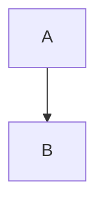

<!-- case: atx-h1-6 -->

# H1

## H2

### H3

#### H4

##### H5

###### H6


<!-- case: setext -->

Title
=====

Sub
-----


<!-- case: atx-closing-hashes -->

## Heading ##


<!-- case: heading-inline -->

# A **bold** and `code` and [link](http://a.com)


<!-- case: emph-basic -->

*a* _b_ **c** __d__ ***e*** ~~f~~


<!-- case: emph-intraword -->

foo*bar*baz and snake_case_word and 2*3*4


<!-- case: emph-nested -->

**bold with *italic* inside** and *italic with **bold** inside*


<!-- case: emph-underline-html -->

text <u>underlined</u> text


<!-- case: bullets-dash -->

- a
- b
  - c
    - d


<!-- case: bullets-star-plus -->

* a
* b

+ c
+ d


<!-- case: ordered-start5 -->

5. five
6. six
7. seven


<!-- case: ordered-paren -->

1) one
2) two


<!-- case: ordered-all-ones -->

1. a
1. b
1. c


<!-- case: list-loose -->

- a

- b

- c


<!-- case: list-tight -->

- a
- b
- c


<!-- case: list-code-inside -->

- item

  ```js
  const x = 1
  ```

- next


<!-- case: list-multi-para -->

1. first para

   second para in item

2. next


<!-- case: list-mixed-nesting -->

1. one
   - sub bullet
   - sub bullet 2
2. two
   1. sub ordered


<!-- case: list-quote-inside -->

- item
  > quoted in item


<!-- case: blockquote-nested -->

> a
>
> > b
> >
> > > c


<!-- case: blockquote-with-list-code -->

> - x
> - y
>
> ```
> code
> ```


<!-- case: blockquote-lazy -->

> line one
lazy continuation


<!-- case: hardbreak-2space -->

line one  
line two


<!-- case: hardbreak-backslash -->

line one\
line two


<!-- case: softbreak -->

line one
line two


<!-- case: fence-backtick-lang -->

```python title="x.py"
print(1)
```


<!-- case: fence-tilde -->

~~~js
const a = 1
~~~


<!-- case: fence-with-backticks-inside -->

````md
```js
x
```
````


<!-- case: fence-no-lang -->

```
plain
```


<!-- case: fence-empty -->

```
```


<!-- case: indented-code -->

para

    indented code
    more

after


<!-- case: inline-code-backticks -->

use ``a ` b`` and `x`


<!-- case: html-inline-br -->

a<br>b<br/>c


<!-- case: html-sub-sup-kbd -->

H<sub>2</sub>O, x<sup>2</sup>, press <kbd>Ctrl</kbd>+<kbd>C</kbd>


<!-- case: html-details -->

<details>
<summary>Click</summary>

Hidden **content**

</details>


<!-- case: html-block-div -->

<div align="center">
  
</div>


<!-- case: html-comment -->

before

<!-- a comment -->

after


<!-- case: html-img-tag -->


<!-- case: html-mark -->

a <mark>hi</mark> b


<!-- case: ref-link -->

[text][ref] and [other]

[ref]: https://example.com "Title"
[other]: https://o.com


<!-- case: ref-image -->

![alt][img]

[img]: https://example.com/a.png


<!-- case: autolink-angle -->

<https://example.com> and <me@example.com>


<!-- case: bare-url -->

see https://example.com/path?x=1 and www.example.com now


<!-- case: link-title -->

[t](https://a.com "The Title") and [u](<url with spaces> "x")


<!-- case: link-parens-url -->

[w](https://en.wikipedia.org/wiki/Foo_(bar))


<!-- case: link-relative-md -->

[other](./other.md) [anchor](#heading) [up](../x.md#sec)


<!-- case: link-inline-formatted -->

[**bold** link](http://a.com) and **[link in bold](http://b.com)**


<!-- case: escapes -->

\*not em\* \# not heading \[not link\] 1\. not list \_u\_ \`x\`


<!-- case: special-chars -->

a * b _ c # d | e < f > g & h ~ i ` j


<!-- case: entities -->

&copy; &amp; &lt;tag&gt; &nbsp; &#169; &mdash;


<!-- case: unicode -->

café — “quotes” … 日本語 🎉 ✓


<!-- case: hr-variants -->

a

---

b

***

c

___

d

- - -


<!-- case: table-basic -->

| a | b |
|---|---|
| 1 | 2 |


<!-- case: table-align -->

| L | C | R |
|:--|:-:|--:|
| 1 | 2 | 3 |


<!-- case: table-inline-fmt -->

| **b** | `c` | [l](http://a.com) |
|---|---|---|
| *i* | ~~s~~ | $x^2$ |


<!-- case: table-escaped-pipe -->

| a | b |
|---|---|
| x \| y | z |


<!-- case: table-empty-cells -->

| a | b | c |
|---|---|---|
| | 2 | |
| 1 | | 3 |


<!-- case: table-no-outer-pipes -->

a | b
--|--
1 | 2


<!-- case: table-ragged -->

| a | b | c |
|---|---|---|
| 1 |
| 1 | 2 | 3 | 4 |


<!-- case: table-br-in-cell -->

| a |
|---|
| line1<br>line2 |


<!-- case: table-wide-ctx -->

before

| a | b |
|---|---|
| 1 | 2 |

after


<!-- case: table-image-cell -->

| img |
|---|
|  |


<!-- case: task-list -->

- [ ] todo
- [x] done
  - [ ] nested


<!-- case: task-ordered -->

1. [ ] one
2. [x] two


<!-- case: strike -->

a ~~gone~~ b ~single~ c


<!-- case: footnote -->

Text with note[^1] and another[^long].

[^1]: The footnote.
[^long]: Multi
    line.


<!-- case: frontmatter -->

---
title: Hello
tags: [a, b]
date: 2026-01-01
---

# Body


<!-- case: frontmatter-hr-confusion -->

intro

---

text

---

more


<!-- case: highlight -->

a ==highlighted== b


<!-- case: sub-super-tilde-caret -->

H~2~O and x^2^ and 2^10^


<!-- case: alert-note -->

> [!NOTE]
> Useful information.

> [!WARNING]
> Danger.

> [!TIP]
> tip


<!-- case: alert-obsidian-callout -->

> [!info] Title here
> Body

> [!faq]- Folded
> hidden


<!-- case: emoji-shortcode -->

Hello :smile: :+1: :rocket:


<!-- case: deflist -->

Term
: Definition one
: Definition two

Term 2
:   Another


<!-- case: math-inline -->

inline $E=mc^2$ and $a_b$ and $\frac{1}{2}$


<!-- case: math-block-multiline -->

$$
\int_0^1 x\,dx
= \tfrac12
$$


<!-- case: math-block-oneline -->

$$x^2 + y^2$$


<!-- case: math-currency -->

costs $5 and $10, or $5-$10; US$3.50


<!-- case: math-in-list -->

- item $a+b$
- $$c$$


<!-- case: math-latex-parens -->

old style \(x^2\) and \[y^2\]


<!-- case: math-aligned -->

$$
\begin{aligned}
a &= b \\
c &= d
\end{aligned}
$$


<!-- case: image-title -->


<!-- case: image-size-obsidian -->

 and 


<!-- case: image-in-link -->

[](https://x.com)


<!-- case: image-no-alt -->


<!-- case: image-spaces-url -->


<!-- case: image-own-paragraph-and-text -->

text  text


<!-- case: wikilink -->

See [[Other Note]] and [[Note|alias]] and ![[embed.png]]


<!-- case: obsidian-tag-comment -->

#tag and %%comment%% and ^block-id


<!-- case: mermaid -->




<!-- case: trailing-hashes-text -->

Issue #12 and C# and #hashtag


<!-- case: numbered-heading-like -->

1986\. A great year


<!-- case: html-entity-in-code -->

`&amp; <b>` stays

```
&amp; <b>
```


<!-- case: nbsp-literal -->

a b


<!-- case: empty-paragraphs-multi-blank -->

a


b


<!-- case: tabs-indent -->

-	tab item
	-	nested


<!-- case: toc-marker -->

[TOC]

# A


<!-- case: abbr-and-misc -->

*[HTML]: Hyper Text

The HTML spec.


<!-- case: link-ref-def-only -->

[ref]: https://x.com

text


<!-- case: line-block-space-end -->

trailing spaces   
next


<!-- case: code-lang-case -->

```JavaScript
x
```

```c++
x
```

```unknownlang
x
```


<!-- case: html-table -->

<table><tr><th>A</th><th>B</th></tr><tr><td>1</td><td>2</td></tr></table>


<!-- case: html-p-align -->

<p align="center">centered</p>


<!-- case: svg-inline -->

<svg width="10" height="10"><circle cx="5" cy="5" r="4"/></svg>
